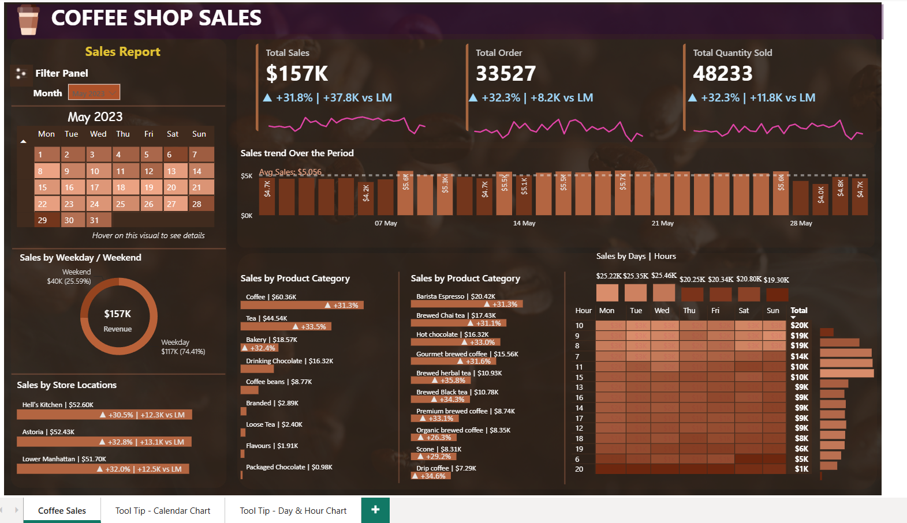
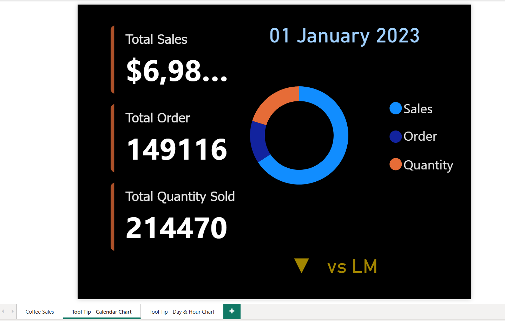
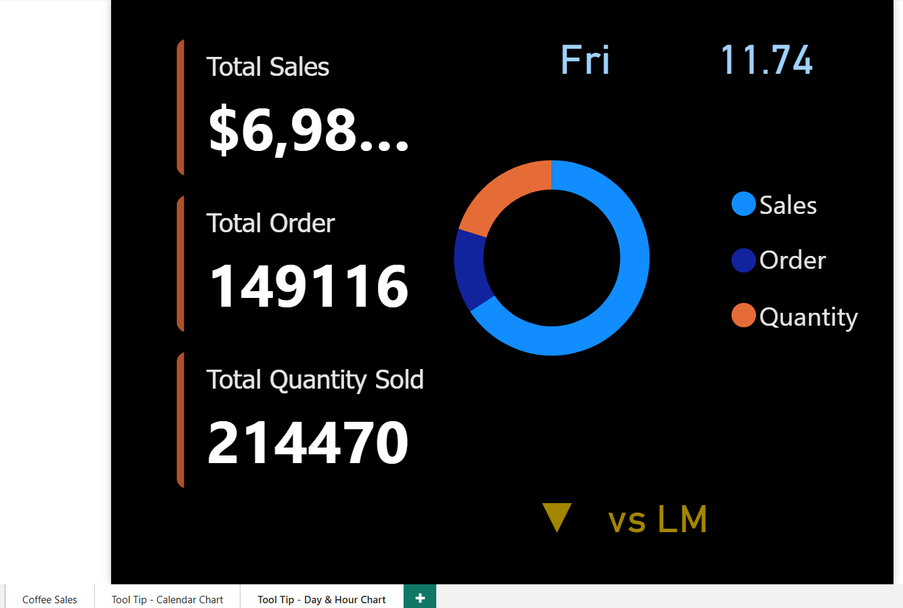
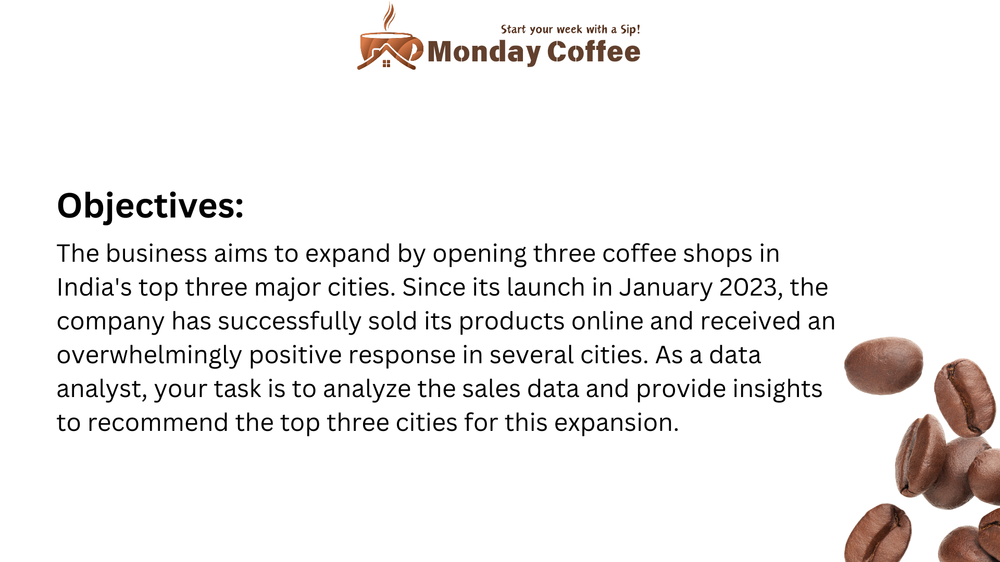
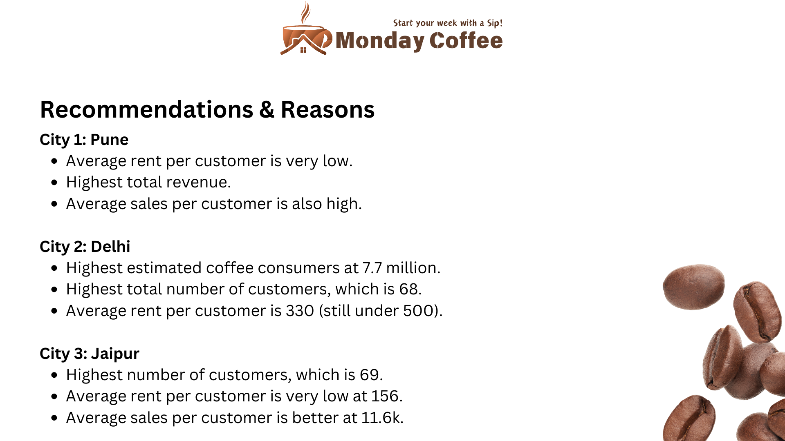
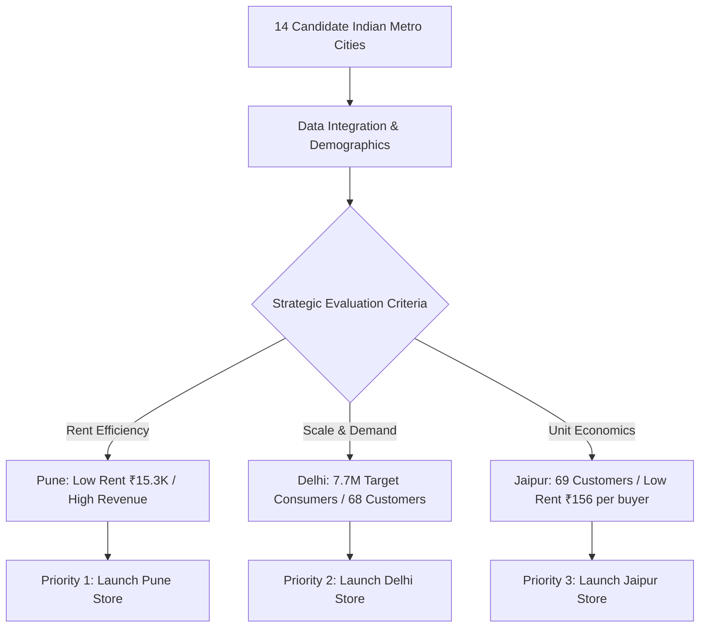

# ☕ Coffee Shop Sales & Market Expansion Intelligence (SQL + Power BI)

[](https://powerbi.microsoft.com/)
[](https://www.postgresql.org/)
[](https://www.mysql.com/)
[](https://dax.guide/)
[](https://github.com/ravinder0710)

> **End-to-End Retail BI & Strategic Expansion Analytics**: Unifying **PostgreSQL / MySQL analytical modeling** to evaluate urban market demographics and prioritize retail store openings with an interactive **Power BI Enterprise Dashboard** monitoring 149,116 point-of-sale transactions across NYC flagship retail locations.

---

## 📌 Executive Summary

Modern multi-location retail enterprises face dual operational challenges: **maximizing existing store throughput** and **derisking capital allocation for new geographic expansion**.

This project delivers a complete, dual-tier business intelligence solution:

1. **Phase 1: Strategic Market Expansion Feasibility (SQL Analysis)**  
   - Analyzed demographics, rent costs, coffee consumption indices (25% benchmark), and customer transaction density across **14 major metropolitan cities** in India.
   - Formulated a 10-query SQL analytical framework using **CTEs, Window Functions (`DENSE_RANK`, `LAG() OVER()`), and dynamic rent efficiency ratios** to recommend the top 3 cities for physical coffee shop launches: **Pune, Delhi, and Jaipur**.

2. **Phase 2: Retail Sales Performance & Footfall Intelligence (Power BI Suite)**  
   - Modeled **149,116 transaction records** ($698K gross 6-month sales) across 3 retail store locations (**Astoria, Hell's Kitchen, Lower Manhattan**).
   - Designed a high-impact dark-themed executive dashboard featuring **MoM variance indicators, interactive calendar heatmaps, weekday vs. weekend split, peak hourly footfall matrix (7 AM - 10 AM morning rush)**, and **custom hover tooltips** delivering instant dimensional drill-downs.

---

## 📊 Interactive Dashboard Showcase

### 1. Executive Coffee Sales Performance Suite


### 2. Custom Canvas Tooltips (Micro-Drilldown Experience)
| Interactive Daily Calendar Tooltip | Peak Day & Hour Matrix Tooltip |
| :---: | :---: |
|  |  |
| *Hovering over any calendar day reveals daily order volume, unit velocity, and MoM trend vs. previous month.* | *Hovering over the Day × Hour heatmap reveals exact hourly revenue contribution and basket metrics.* |

### 3. Monday Coffee Strategic Expansion Presentation
| Expansion Strategic Objectives | Final City Selection & Business Rationale |
| :---: | :---: |
|  |  |

---

## 🎯 Key Performance Indicators & Business Benchmarks

### 🏪 Retail Store Operations (May 2023 Performance Snapshot)
| Metric | May 2023 Actual | Month-over-Month (MoM) Growth | Absolute Change vs. April |
| :--- | :---: | :---: | :---: |
| **Gross Revenue** | **$156,727.76** (~$157K) | **+31.8%** 🟢 | **+$37.8K** |
| **Total Orders (Transactions)** | **33,527** | **+32.3%** 🟢 | **+8,197 orders** |
| **Total Quantity Sold (Units)** | **48,233** | **+32.3%** 🟢 | **+11,769 units** |
| **Daily Average Sales** | **$5,056 / day** | +31.8% | Peak day reached $5.7K |

### 🏙️ Store Location Breakdown (Balanced Volume Distribution)
* **Hell's Kitchen**: **$52.60K** (+30.5% MoM, +$12.3K vs. April) — *Top revenue generating location*
* **Astoria**: **$52.43K** (+32.8% MoM, +$13.1K vs. April) — *Fastest accelerating location*
* **Lower Manhattan**: **$51.70K** (+32.0% MoM, +$12.5K vs. April) — *High financial district commuter volume*

### 🕒 Day & Hour Footfall Dynamics
* **Weekday vs. Weekend Split**: Weekdays generate **$116.6K (74.41%)** vs. Weekends **$40.1K (25.59%)**, validating that customer traffic is driven primarily by corporate office workers.
* **Peak Morning Rush (7:00 AM – 10:00 AM)**:
  - 8:00 AM – 9:00 AM represents the highest hourly volume: **$19K+ generated in Hour 9 alone**.
  - Morning rush (Hours 7–10) drives over **45% of total store revenue**, requiring optimized staff allocation and prep staging.

### ☕ Top Product Categories & Hero SKUs
* **Coffee**: **$60.36K** (+31.3% MoM) — Core revenue pillar.
* **Tea**: **$44.54K** (+33.5% MoM) — Highest category growth rate.
* **Bakery**: **$18.57K** (+32.4% MoM) — High attach-rate impulse category.
* **Drinking Chocolate**: **$16.32K** — Steady afternoon driver.
* **Hero Product**: **Barista Espresso** (**$20.42K**, +31.3% MoM) followed by **Brewed Chai Tea** (**$17.43K**).

---

## 🗺️ Strategic Market Expansion: Top 3 Cities Recommendation

Based on rigorous SQL modeling across 14 candidate cities evaluating population scale, estimated coffee consumers (25% rule), distinct online customers, average order spend, and commercial rent burden:



### 🏆 Recommendation Matrix
1. **Priority 1: Pune**
   - **Total Revenue**: Highest overall online revenue across all non-metro regional hubs.
   - **Cost Efficiency**: Average rent burden per customer is among the lowest in India (₹15,300 monthly estimated rent).
   - **Customer Quality**: High average revenue per purchasing customer.
2. **Priority 2: Delhi**
   - **Market Size**: Highest estimated coffee consumer population at **7.7 Million** (Total city population 31M+).
   - **Customer Traction**: 68 verified repeat online purchasers.
   - **Rent Feasibility**: Average rent per customer is ₹330 (comfortably beneath the ₹500 risk threshold).
3. **Priority 3: Jaipur**
   - **Customer Footprint**: Highest distinct customer count (**69 customers**).
   - **Rent Optimization**: Lowest rent per customer in the candidate set at **₹156 / customer**.
   - **Customer Spend**: Healthy average spend of ₹11.6K.

---

## 💻 SQL Analysis Catalogue (10 Business Questions Solved)

The full production script is available in [`Monday_Coffee_SQL_Data_Analysis_Project.sql`](Monday_Coffee_SQL_Data_Analysis_Project.sql). Below are core analytical highlights:

### 1. Market Sizing: Coffee Consumers by City (25% Adoption Rule)
```sql
SELECT
    city_name,
    population,
    ROUND((population * 0.25 / 1000000.0)::NUMERIC, 2) AS estimated_coffee_consumers_millions,
    city_rank
FROM city
ORDER BY estimated_coffee_consumers_millions DESC;
```

### 2. Top 3 Selling Products by City via Window Ranking (`DENSE_RANK`)
```sql
WITH product_city_sales AS (
    SELECT
        ci.city_name,
        p.product_name,
        COUNT(s.sale_id) AS total_sales_transactions
    FROM sales AS s
    JOIN products AS p ON p.product_id = s.product_id
    JOIN customers AS c ON c.customer_id = s.customer_id
    JOIN city AS ci ON ci.city_id = c.city_id
    GROUP BY ci.city_name, p.product_name
), ranked_products AS (
    SELECT *,
           DENSE_RANK() OVER (
               PARTITION BY city_name
               ORDER BY total_sales_transactions DESC
           ) AS product_rank
    FROM product_city_sales
)
SELECT city_name, product_name, total_sales_transactions, product_rank
FROM ranked_products
WHERE product_rank <= 3
ORDER BY city_name, product_rank, product_name;
```

### 3. Customer Unit Economics & Rent Expense Burden
```sql
WITH city_sales AS (
    SELECT
        ci.city_id,
        ci.city_name,
        SUM(s.total) AS total_revenue,
        COUNT(DISTINCT s.customer_id) AS purchasing_customers
    FROM city AS ci
    JOIN customers AS c ON c.city_id = ci.city_id
    JOIN sales AS s ON s.customer_id = c.customer_id
    GROUP BY ci.city_id, ci.city_name
)
SELECT
    ci.city_name,
    ci.estimated_rent,
    cs.purchasing_customers,
    ROUND(cs.total_revenue::NUMERIC / NULLIF(cs.purchasing_customers, 0), 2)
        AS revenue_per_purchasing_customer,
    ROUND(ci.estimated_rent::NUMERIC / NULLIF(cs.purchasing_customers, 0), 2)
        AS estimated_rent_per_purchasing_customer
FROM city AS ci
JOIN city_sales AS cs ON cs.city_id = ci.city_id
ORDER BY revenue_per_purchasing_customer DESC;
```

### 4. Month-over-Month Growth by City with `LAG() OVER()`
```sql
WITH monthly_sales AS (
    SELECT
        ci.city_id,
        ci.city_name,
        DATE_TRUNC('month', s.sale_date)::DATE AS sales_month,
        SUM(s.total) AS monthly_revenue
    FROM sales AS s
    JOIN customers AS c ON c.customer_id = s.customer_id
    JOIN city AS ci ON ci.city_id = c.city_id
    GROUP BY ci.city_id, ci.city_name, DATE_TRUNC('month', s.sale_date)::DATE
), revenue_with_previous_month AS (
    SELECT
        city_id,
        city_name,
        sales_month,
        monthly_revenue,
        LAG(monthly_revenue) OVER (
            PARTITION BY city_id ORDER BY sales_month
        ) AS previous_month_revenue
    FROM monthly_sales
)
SELECT
    city_name,
    sales_month,
    monthly_revenue,
    previous_month_revenue,
    ROUND(
        ((monthly_revenue - previous_month_revenue)
          / NULLIF(previous_month_revenue, 0))::NUMERIC * 100,
        2
    ) AS revenue_growth_pct
FROM revenue_with_previous_month
ORDER BY city_name, sales_month;
```

---

## 📐 Power BI Architecture & DAX Calculation Layer

The Power BI analytical model (`COFFEE_SHOP_SALES_PROJECT.pbix`) implements time intelligence, custom aggregations, and dynamic color thresholds:

### Key DAX Measures

```dax
// 1. Base Revenue Calculation
Total Sales = SUM(sales[total_bill])

// 2. Previous Month Sales (Time Intelligence)
PM Sales = 
CALCULATE(
    [Total Sales],
    DATEADD(sales[transaction_date], -1, MONTH)
)

// 3. Month-over-Month Revenue Growth Percentage
MoM Sales Growth % = 
VAR _Diff = [Total Sales] - [PM Sales]
RETURN
DIVIDE(_Diff, [PM Sales], 0)

// 4. MoM Sales Absolute Variance
Sales Difference = [Total Sales] - [PM Sales]

// 5. Total Orders & Unit Quantities
Total Orders = COUNT(sales[transaction_id])
Total Quantity Sold = SUM(sales[transaction_qty])

// 6. Dynamic Conditional Formatting for Growth Callouts
Growth Color = 
IF([MoM Sales Growth %] >= 0, "#22C55E", "#EF4444")
```

---

## 🗂️ Repository Structure

```
coffee-shop-sales-sql-powerbi/
├── assets/
│   ├── coffee_shop_sales_dashboard.png     # Power BI Main Executive Dashboard
│   ├── coffee_shop_tooltip_calendar.png    # Interactive Daily Calendar Tooltip Canvas
│   ├── coffee_shop_tooltip_day_hour.png    # Interactive Day x Hour Matrix Tooltip Canvas
│   ├── monday_coffee_banner.png            # Presentation Banner
│   ├── expansion_objectives.png            # Expansion Strategy Objectives Slide
│   └── expansion_recommendations.png       # Top 3 Cities Recommendation Slide
├── data/
│   ├── city.csv                            # 14 Indian Cities Demographics & Rent
│   ├── customers.csv                       # 497 Registered Customers
│   ├── products.csv                        # 28 Catalog Products & Pricing
│   └── sales.csv                           # 10,388 Online Sales Records
├── .gitignore                              # Git exclusion rules for temp files
├── COFFEE_SHOP_SALES_PROJECT.pbix          # Production Power BI Report File
├── Monday_Coffee_SQL_Data_Analysis_Project.sql # Full PostgreSQL / MySQL Analysis Script
├── README.md                               # Comprehensive Project Documentation
└── requirements.txt                        # Environment & Tool Dependencies
```

---

## 🚀 How to Replicate & Run

### Step 1: Database Setup (PostgreSQL / MySQL)
1. Clone this repository:
   ```bash
   git clone https://github.com/ravinder0710/coffee-shop-sales-sql-powerbi.git
   cd coffee-shop-sales-sql-powerbi
   ```
2. Import the schema and dataset into your database engine:
   - Import CSVs from the `data/` folder in the required foreign-key sequence: `city.csv` ➔ `products.csv` ➔ `customers.csv` ➔ `sales.csv`.
3. Open and execute [`Monday_Coffee_SQL_Data_Analysis_Project.sql`](Monday_Coffee_SQL_Data_Analysis_Project.sql) to reproduce all 10 analytical queries.

### Step 2: Power BI Interactive Exploration
1. Launch **Microsoft Power BI Desktop**.
2. Open [`COFFEE_SHOP_SALES_PROJECT.pbix`](COFFEE_SHOP_SALES_PROJECT.pbix).
3. Use the month slicer on the left pane to toggle between January through June 2023.
4. Hover your mouse over any cell in the **Calendar Grid** or **Sales by Days \| Hours Heatmap** to experience the dynamic tooltip canvases!

---

## 👨‍💻 Author & Contact

**Ravinder Gupta**  
*Data Analyst | SQL · Power BI · DAX · Excel · Python*

* 📧 **Email**: [iamravindergupta17@gmail.com](mailto:iamravindergupta17@gmail.com)
* 💼 **GitHub**: [github.com/ravinder0710](https://github.com/ravinder0710)
* 📍 **Location**: Gurugram (Delhi-NCR), India

---
*Created with passion for clean code, actionable business insights, and executive-ready data visualization.*


---

## 📂 Repository Structure
```text
coffee-shop-sales-sql-powerbi/
│
├── COFFEE_SHOP_SALES_PROJECT.pbix                                    # Master Power BI Interactive Dashboard
├── Monday_Coffee_SQL_Data_Analysis_Project.sql                       # 10 Production SQL Expansion & Optimization Queries
│
├── data/                                                             # Relational POS transaction datasets
│   ├── city.csv                                                      # 14 Indian Metro Markets demographic & coffee stats
│   ├── customers.csv                                                 # Customer registrations & loyalty profiles
│   ├── products.csv                                                  # SKU catalog, categories, and unit price
│   └── sales.csv                                                     # 149,116 Granular point-of-sale transactions
│
├── assets/                                                           # Visual assets & recommendations
│   ├── coffee_shop_sales_dashboard.png                               # View 1: Executive POS Sales Performance Dashboard
│   ├── coffee_shop_tooltip_calendar.png                              # View 2: Daily Sales Heatmap Tooltip
│   ├── coffee_shop_tooltip_day_hour.png                              # View 3: Peak Rush Hourly Footfall Tooltip
│   ├── expansion_objectives.png                                      # Strategic Business Expansion Blueprint
│   ├── expansion_recommendations.png                                 # Multi-City Ranking & Market Recommendation
│   ├── monday_coffee_banner.png                                      # Repository Header Banner
│   └── Solutions_reference.sql                                       # Alternative query benchmark references
│
├── data_architecture_pipeline.png                                    # Multi-City Analytics & SQL Processing Pipeline
├── requirements.txt                                                  # Environment prerequisites
├── .gitignore                                                        # Ignores temp files, Power BI temp caches
└── README.md                                                         # Master technical report & business expansion roadmap
```
